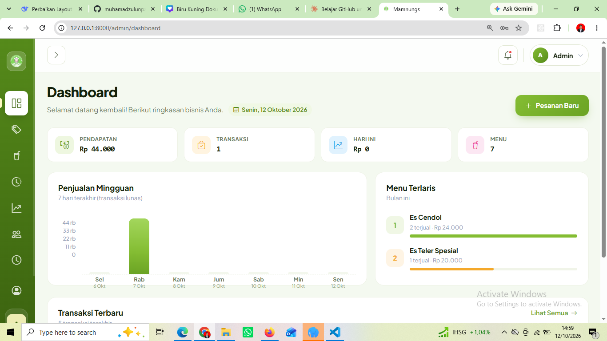
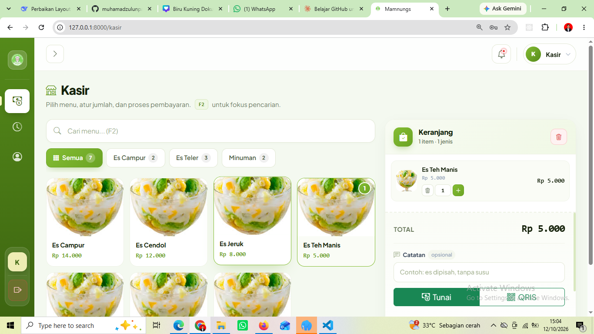
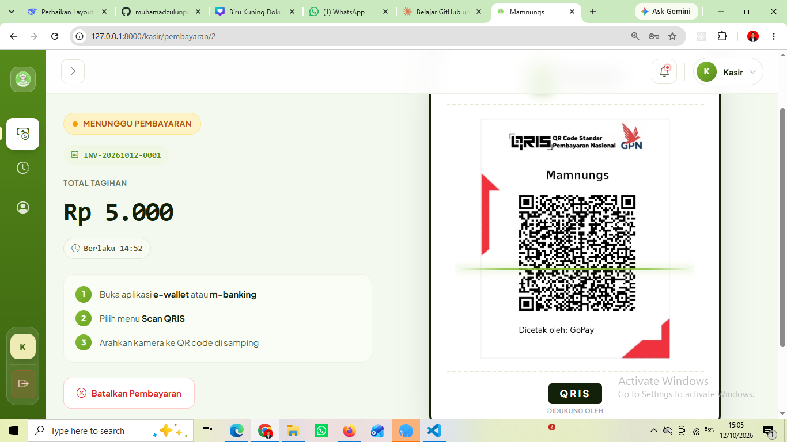
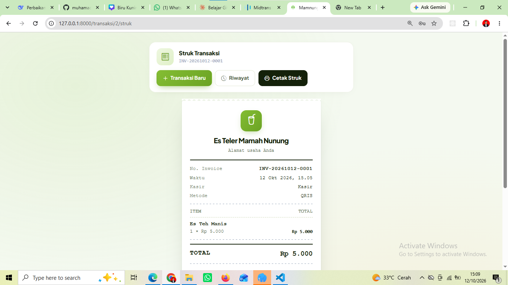
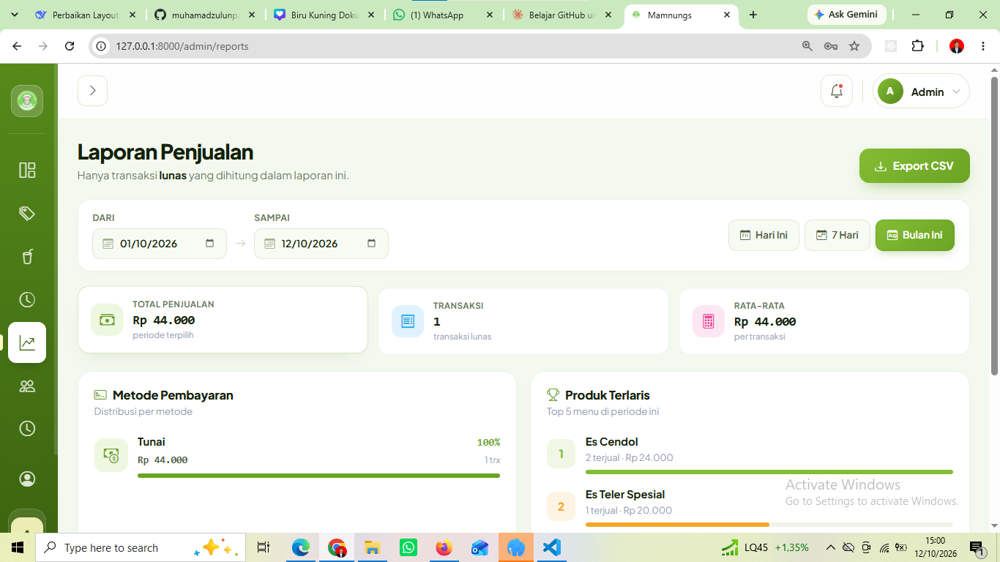
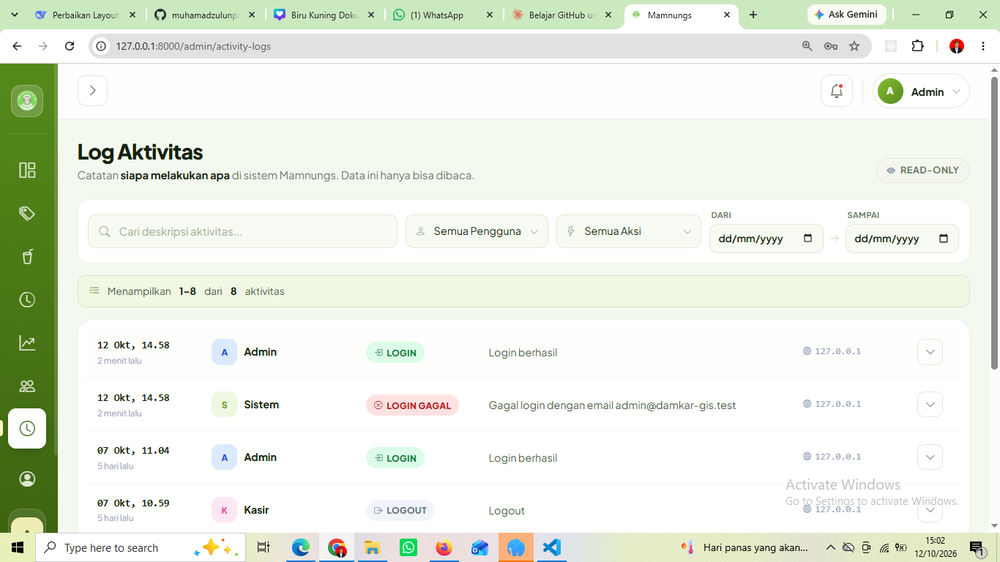

# Mamnungs

**UMKM Point of Sale & Payment System**: aplikasi kasir berbasis web untuk usaha Es Teler, dengan pembayaran tunai dan QRIS (Midtrans), struk cetak, laporan penjualan, dan log aktivitas.


> Proyek portofolio yang dibuat untuk kebutuhan nyata usaha Es Teler Mamah Nunung. Seluruh pengembangan dikerjakan dengan alur kerja Git ala tim: satu fitur satu branch, lalu Pull Request.

## Screenshot

| Dashboard Admin | Kasir (POS) |
|---|---|
|  |  |

| Pembayaran QRIS | Struk |
|---|---|
|  |  |

| Laporan | Log Aktivitas |
|---|---|
|  |  |

## Fitur

### Kasir
- Menu produk dengan pencarian dan filter kategori
- Keranjang: tambah, ubah jumlah, catatan pesanan
- Pembayaran **tunai** (uang diterima, tombol uang pas, kembalian otomatis)
- Pembayaran **QRIS** lewat Midtrans, dengan status yang diperbarui otomatis
- Struk siap cetak (format thermal) dan riwayat transaksi sendiri

### Admin
- Dashboard: pendapatan dan transaksi bulan ini (dibanding bulan lalu), penjualan hari ini, grafik 7 hari, menu terlaris, transaksi terbaru
- Manajemen **kategori** dan **produk** (foto, harga, status tersedia/habis)
- **Laporan** penjualan dengan filter tanggal, rincian Cash vs QRIS, produk terlaris, dan export CSV
- **Manajemen pengguna**: tambah, ubah, nonaktifkan, dan hapus akun admin/kasir
- **Log aktivitas**: siapa login, mengubah data, membuat transaksi, dan lainnya

### Semua pengguna
- Profil: identitas, ganti nama, ganti password, dan log aktivitas pribadi

## Keputusan desain

- **Harga dan nama produk disalin ke `order_items`**, sehingga transaksi lama tetap menampilkan harga saat itu walau harga produk berubah.
- **Total dihitung ulang di server** dari database. Data harga dari browser tidak dipercaya.
- **Status pembayaran QRIS hanya berasal dari Midtrans** (pengecekan status dan webhook), bukan dari frontend.
- **Webhook diverifikasi dengan signature** dan aman jika terkirim dua kali (hanya order `PENDING` yang bisa berubah).
- **Checkout memakai database transaction**, dan nomor invoice (`INV-YYYYMMDD-0001`) dikunci agar tidak ganda saat dua kasir bersamaan.
- **Produk memakai soft delete** agar riwayat transaksi tetap utuh.
- **Pembatasan akses berdasarkan role** lewat middleware; akun nonaktif otomatis dikeluarkan.
- **Password tidak pernah ditulis di log aktivitas.**

## Tech stack

| Bagian | Teknologi |
|---|---|
| Backend | Laravel (PHP 8.3) |
| Frontend | Vue 3 + Inertia.js |
| UI | Bootstrap 5 + Bootstrap Icons |
| Database | MySQL |
| Pembayaran | Midtrans (QRIS, Core API) |
| Build tool | Vite |

## Alur pembayaran

```text
Kasir pilih produk → keranjang → checkout
        │
        ├── TUNAI → order PAID → struk
        │
        └── QRIS  → order PENDING → QR dari Midtrans
                         │
                  pelanggan membayar
                         │
        webhook / pengecekan status → order PAID → struk
```

Status order: `PENDING`, `PAID`, `CANCELLED`, `EXPIRED`.

## Instalasi

### Kebutuhan

- PHP 8.2+ dan Composer
- Node.js 18+ dan npm
- MySQL
- Akun [Midtrans Sandbox](https://dashboard.sandbox.midtrans.com) (untuk QRIS)

### Langkah

```bash
# 1. Clone repository
git clone https://github.com/USERNAME/mamnungs.git
cd mamnungs

# 2. Pasang dependensi
composer install
npm install

# 3. Siapkan environment
cp .env.example .env
php artisan key:generate
```

Di Windows PowerShell, ganti `cp` dengan `copy .env.example .env`.

Buat database `mamnungs` di MySQL, lalu edit `.env`:

```env
APP_NAME=Mamnungs
APP_TIMEZONE=Asia/Jakarta

DB_CONNECTION=mysql
DB_HOST=127.0.0.1
DB_PORT=3306
DB_DATABASE=mamnungs
DB_USERNAME=root
DB_PASSWORD=

MIDTRANS_SERVER_KEY=
MIDTRANS_CLIENT_KEY=
MIDTRANS_IS_PRODUCTION=false
```

```bash
# 4. Migrasi database, data contoh, dan link storage
php artisan migrate --seed
php artisan storage:link

# 5. Jalankan (dua terminal)
php artisan serve
npm run dev
```

Buka **http://127.0.0.1:8000**.

### Akun demo

> Hanya untuk pengembangan dan demo. **Ganti atau hapus sebelum dipakai di server sungguhan.**

| Role | Email | Password |
|---|---|---|
| Admin | `admin@mamnungs.test` | `password` |
| Kasir | `kasir@mamnungs.test` | `password` |

## Mencoba pembayaran QRIS (sandbox)

1. Isi `MIDTRANS_SERVER_KEY` dan `MIDTRANS_CLIENT_KEY` dari menu **Settings > Access Keys** di dashboard sandbox, lalu jalankan `php artisan config:clear`.
2. Login sebagai kasir, pilih produk, pilih **QRIS**, klik **Buat QRIS**.
3. QR sandbox **tidak bisa dibayar dengan e-wallet asli**. Salin URL gambar QR (klik kanan gambar, *Copy image address*), buka [simulator QRIS Midtrans](https://simulator.sandbox.midtrans.com), tempel URL, lalu klik **Scan QR** dan bayar.
4. Halaman kasir otomatis pindah ke struk setelah pembayaran berhasil.

### Menguji webhook (opsional)

Aplikasi sudah memeriksa status pembayaran secara berkala dari halaman QR. Untuk menguji jalur webhook resmi:

1. Jalankan `ngrok http 8000` dan salin alamat HTTPS-nya.
2. Di dashboard Midtrans sandbox, isi **Payment Notification URL** dengan `https://alamat-ngrok/midtrans/notification`.
3. Lakukan pembayaran di simulator. Request masuk terlihat di `http://127.0.0.1:4040`.

## Struktur proyek

```text
app/
├── Http/Controllers/
│   ├── Admin/            # Dashboard, Kategori, Produk, Laporan, Pengguna, Log Aktivitas
│   ├── Kasir/            # POS dan halaman QRIS
│   ├── OrderController   # Riwayat dan struk
│   ├── ProfileController
│   └── MidtransWebhookController
├── Http/Middleware/      # RoleMiddleware
├── Models/               # termasuk Concerns/LogsActivity
└── Services/MidtransService
resources/js/
├── Layouts/              # DashboardLayout
└── Pages/                # Auth, Admin, Kasir, Transaksi, Profil
```

## Database

```text
users ──┬─< orders ──┬─< order_items >── products >── categories
        │            └── payments
        └─< activity_logs
```

## Keamanan

- File `.env` dan kunci Midtrans tidak disimpan di repository.
- Server Key hanya dipakai di backend.
- Akun demo di seeder wajib diganti sebelum penggunaan nyata.
- Untuk produksi: gunakan kunci Midtrans Production, set `MIDTRANS_IS_PRODUCTION=true`, `APP_DEBUG=false`, dan gunakan HTTPS.

## Rencana pengembangan

- [ ] Menu Pengaturan (nama dan alamat usaha di struk)
- [ ] Diskon dan promo
- [ ] Download struk PDF
- [ ] Manajemen stok bahan
- [ ] Deploy ke hosting

## Alur pengembangan

Proyek dikerjakan per tahap, masing-masing di branch sendiri dan digabung lewat Pull Request:

`setup/foundation` → `fitur/auth-role` → `fitur/kategori` → `fitur/produk` → `fitur/pos-order` → `fitur/riwayat-struk` → `fitur/dashboard` → `fitur/layout` → `fitur/laporan` → `fitur/midtrans-qris` → `fitur/pengguna` → `fitur/activity-log` → `fitur/profil`

## Lisensi

Belum ditentukan. Tambahkan file `LICENSE` jika repository dipublikasikan.